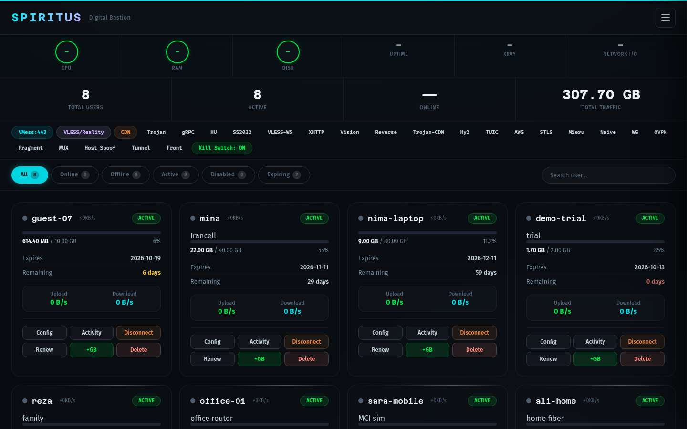
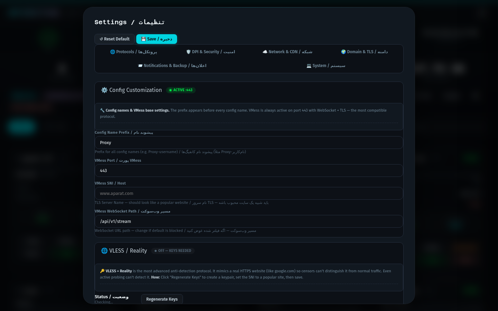
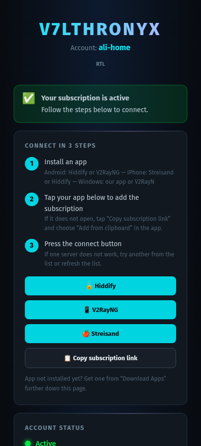
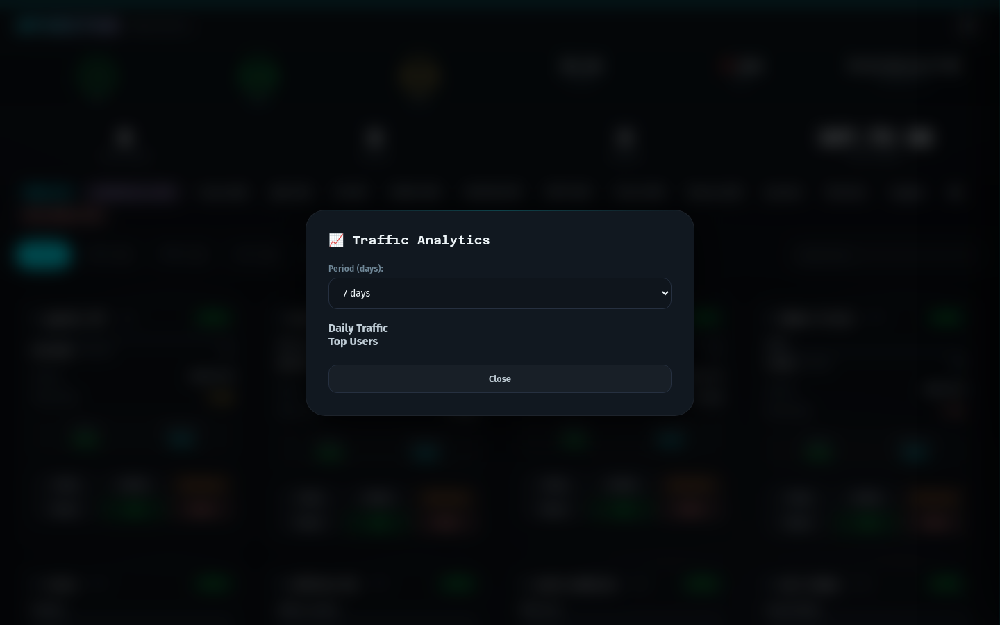
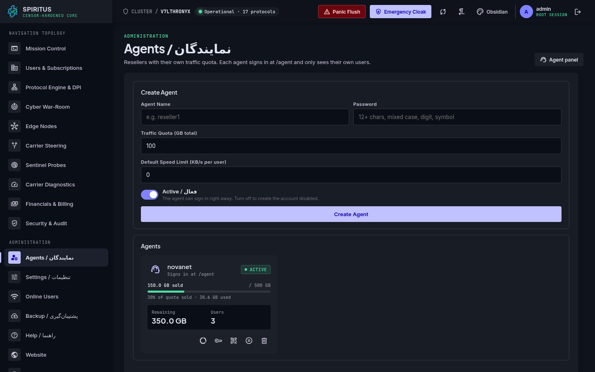
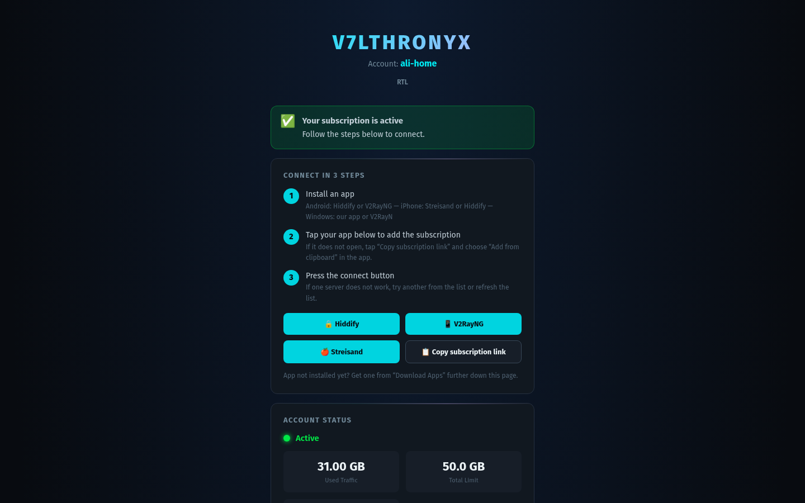

<p align="center">
  
</p>

<h1 align="center">Spiritus</h1>

<p align="center">
  <strong>A modern, security-hardened VPN management panel for Xray-core &amp; sing-box —<br>built for censorship-heavy networks, multi-tenant resellers, and a native mobile client.</strong>
</p>

<p align="center">
  
  
  
  
  
  
</p>

<p align="center">
  <a href="#-highlights">Highlights</a> ·
  <a href="#-screenshots">Screenshots</a> ·
  <a href="#-protocols">Protocols</a> ·
  <a href="#-security">Security</a> ·
  <a href="#-quick-start">Quick Start</a> ·
  <a href="#-mobile-client">Mobile Client</a> ·
  <a href="#فارسی">فارسی</a>
</p>

---

## ✨ Highlights

- **16 transport protocols** spanning Xray-core, sing-box, and WireGuard — REALITY, XHTTP, Vision, CDN-fronting, Hysteria2, TUIC, ShadowTLS, Mieru, NaiveProxy and AmneziaWG.
- **Built-in DPI evasion** — TLS fragmentation, noise padding, REALITY domain-fronting, SNI rotation, and emergency-relay failover.
- **Multi-tenant by design** — admins, traffic-quota agents, and resellers with commission tracking and per-brand subscription pages.
- **Native mobile client** — a Kotlin/Compose Android app (Xray + sing-box + tun2socks engines) that consumes the same subscription API.
- **Security-first** — CSP with per-request nonces, HSTS preload, double-submit CSRF, pinned-algorithm JWT, TOTP 2FA, host-header allowlisting, rate-limiting + fail2ban, and a dependency set audited clean.
- **Operable** — one-command installer, systemd units, Prometheus/Grafana observability, Telegram bot, and automated backups.

---

## 📸 Screenshots

<p align="center">
  
</p>
<p align="center"><em>Admin dashboard — live CPU/RAM/traffic, one-tap protocol toggles, and per-user cards with usage, expiry and speed.</em></p>

<table>
  <tr>
    <td width="50%"><br><sub>Protocol / REALITY / CDN configuration</sub></td>
    <td width="50%"><br><sub>Subscriber view (mobile, RTL)</sub></td>
  </tr>
  <tr>
    <td width="50%"><br><sub>Traffic analytics & top users</sub></td>
    <td width="50%"><br><sub>Agent / reseller management</sub></td>
  </tr>
</table>

<p align="center">
  
</p>
<p align="center"><em>Branded, plain-language subscription page (bilingual, RTL) — what each customer sees.</em></p>

---

## 🔌 Protocols

| Engine | Protocol | Transport / Flow | TLS | CDN |
|--------|----------|------------------|:---:|:---:|
| Xray | **VLESS + XHTTP + REALITY** | XHTTP, relay-domain fronting | REALITY | — |
| Xray | **VLESS + REALITY + Vision** | XTLS-Vision (fresh IP) | REALITY | — |
| Xray | **VLESS-Reverse-REALITY** | backhaul / rathole tunnel | REALITY | — |
| Xray | **VLESS + WS / gRPC / HTTPUpgrade** | WebSocket, gRPC, HTTPUpgrade | ✅ | ✅ |
| Xray | **VMess + WS + TLS** | WebSocket | ✅ | ✅ |
| Xray | **Trojan-CDN** | WS / gRPC behind CDN | ✅ | ✅ |
| Xray | **Shadowsocks-2022** | TCP (blake3-AES-GCM) | — | — |
| sing-box | **Hysteria2** | QUIC + Salamander + port-hop | ✅ | — |
| sing-box | **TUIC v5** | QUIC | ✅ | — |
| sing-box | **ShadowTLS v3** | TLS camouflage | ✅ | — |
| standalone | **Mieru** | obfuscated TCP/UDP | — | — |
| standalone | **NaiveProxy** | HTTP/2 CONNECT | ✅ | ✅ |
| WireGuard | **AmneziaWG 2.0** | UDP (obfuscated WG) | — | — |

Subscriptions are served as Base64 share-links (`/sub-api/{uuid}`), a JSON profile (`/sub-json/{uuid}`), and a styled HTML page (`/sub/{uuid}`), with `Subscription-Userinfo` traffic/expiry headers that any standard client understands.

---

## 🔒 Security

Spiritus is built to be exposed to hostile networks. Defenses are layered:

**Transport & headers**
- Content-Security-Policy with **per-request nonces** (no `unsafe-inline`)
- HSTS `max-age=2y; includeSubDomains; preload`
- `X-Content-Type-Options`, `X-Frame-Options: DENY`, `Referrer-Policy: no-referrer`, `Permissions-Policy`, COOP/CORP
- **Host-header allowlist** (`ALLOWED_HOSTS`) — neutralizes Host / BadHost poisoning
- **Request body-size cap** (`MAX_REQUEST_BODY_BYTES`) — anti-DoS

**Authentication & sessions**
- Argon2 password hashing with a configurable strength policy
- **TOTP 2FA** with one-time challenge tokens
- JWT pinned to **HS256** — `alg:none` and algorithm-confusion rejected; JTI revocation list
- Cookies are `HttpOnly` + `Secure` + `SameSite=Strict`
- **Double-submit-cookie CSRF** on every unsafe method
- Brute-force lockout + global rate-limiting + fail2ban integration
- **Mobile refresh tokens** — single-use rotation with reuse detection (a replayed token revokes the whole session family)
- Optional **admin IP allowlist** (`ADMIN_IP_ALLOWLIST`)

**Data & auditing**
- **Tamper-evident audit log** — HMAC hash-chain, verifiable via `GET /api/security/audit/verify`
- **Encrypted backups** (Fernet) with `0600` permissions
- Honeypot endpoints that feed the audit log and fail2ban

**Supply chain & code**
- Dependencies **audited with `pip-audit` (0 known CVEs)** and pinned to patched floors
- `bandit` static analysis; SSRF-safe resolver; mTLS for the privileged helper
- Optional Prometheus alert rules for failed logins, honey-tokens, and pool exhaustion

> See [SECURITY.md](SECURITY.md) for the threat model and responsible-disclosure policy.

---

## 🚀 Quick Start

**Requirements:** a fresh Linux server (Debian/Ubuntu recommended), root access, and a domain pointed at it.

**One-line install** — downloads and runs the installer, which clones the repo into `/opt/v7lthronyx`:

```bash
bash <(curl -sL https://raw.githubusercontent.com/v74all/Spiritus/main/install.sh)
```

Useful flags:

```bash
sudo ./install.sh --port 8080         # custom web port
sudo ./install.sh --help              # all options
sudo ./install.sh uninstall           # remove (keep data)
sudo ./install.sh uninstall --purge   # remove everything
```

The installer provisions PostgreSQL + Redis, a Python virtualenv, Xray/sing-box binaries, TLS certificates (acme.sh), the systemd service, and an Nginx fallback.

**Manual / development run:**

```bash
python -m venv venv && source venv/bin/activate
pip install -r requirements.txt
cp .env.example .env          # then edit the secrets (see below)
uvicorn app.main:app --host 127.0.0.1 --port 38471
```

---

## ⚙️ Configuration

All settings come from environment variables (`.env`). The essentials:

| Variable | Purpose |
|----------|---------|
| `SECRET_KEY`, `JWT_SECRET_KEY` | **Required.** Unique high-entropy secrets. |
| `DATABASE_URL` | PostgreSQL DSN (SQLite for local dev). |
| `REDIS_URL` | Rate-limit / session store. |
| `ALLOWED_HOSTS` | **Recommended.** Comma-separated panel domain(s). |
| `MAX_REQUEST_BODY_BYTES` | Max request body in bytes (default 2 MiB). |
| `ADMIN_BOOTSTRAP_PASSWORD` | One-shot first-admin password (auto-cleared). |
| `CORS_ORIGINS` | Off by default; set an explicit allowlist if needed. |
| `ADMIN_IP_ALLOWLIST` | Optional IPs/CIDRs allowed to reach the admin API (loopback always allowed). |
| `BACKUP_ENCRYPTION_KEY` | Dedicated key for encrypted backups (else derived from `SECRET_KEY`). |
| `TELEGRAM_WEBHOOK_SECRET` | Enables `POST /api/telegram/webhook` (≥16 chars; pass as `secret_token` to `setWebhook`). |
| `MOBILE_REFRESH_LIFETIME_DAYS` | Mobile refresh-token lifetime (default 30). |

> ⚠️ Never commit a real `.env`. It is git-ignored by default — keep it that way.

---

## 📱 Mobile Client

A native **Android** app (Kotlin + Jetpack Compose) ships alongside the panel:

- Imports subscriptions or individual `vless / vmess / trojan / ss / hysteria2 / tuic / wireguard` links — works with **any** panel, not just Spiritus.
- Bundles **Xray**, **sing-box**, and **tun2socks** engines (arm64-v8a, armeabi-v7a, x86_64).
- Built-in **management mode**: admins and agents can run the panel from their phone.
- QR import, per-config latency testing, split-tunneling, kill-switch, and a live traffic gauge.

---

## 🏗️ Architecture

```
                 ┌───────────────┐      ┌──────────────┐
   Browser ─────▶│  FastAPI app  │◀────▶│  PostgreSQL  │
   Mobile  ─────▶│  (Spiritus)   │◀────▶│    Redis     │
                 └──────┬────────┘      └──────────────┘
                        │ privileged helper (mTLS)
                        ▼
        ┌──────────────────────────────────────────┐
        │  Xray-core · sing-box · WireGuard · DPI   │
        └──────────────────────────────────────────┘
```

- **`app/protocol_engine.py`** — single source of truth for every protocol & share-link.
- **`app/api/`** — admin, agents, resellers, payments, security, system, DPI, and domain routers.
- **`app/middleware/`** — CSRF + rate-limit. **`app/privileged_helper*`** — least-privilege service control over mTLS.

---

## 🧪 Development

```bash
pip install -r requirements-dev.txt
pytest -q                 # security & contract test suite
pip-audit                 # dependency CVE scan
bandit -c pyproject.toml -r app main.py   # static analysis
ruff check app tests main.py             # lint
```

Kubernetes: a Helm chart lives in [`deploy/helm/spiritus`](deploy/helm/spiritus) (probes: `/api/ready`, `/api/live`).

---

## 📜 License

Released under the [MIT License](LICENSE).

> Spiritus is intended for lawful privacy, anti-censorship, and authorized network administration. You are responsible for complying with the laws and regulations that apply to you.

---

<a id="فارسی"></a>

## 🇮🇷 فارسی

**Spiritus** یک پنل مدیریت VPN مدرن و **امنیت‌محور** برای Xray-core و sing-box است؛ ساخته‌شده برای شبکه‌های پرسانسور، نمایندگی/رزلرِ چندمستاجری، و یک **کلاینت موبایل بومی**.

**ویژگی‌ها**
- **۱۶ پروتکل** روی Xray / sing-box / WireGuard — REALITY، XHTTP، Vision، CDN-fronting، Hysteria2، TUIC، ShadowTLS، Mieru، NaiveProxy، AmneziaWG.
- **دور زدن DPI** — فرگمنت TLS، نویز، domain-fronting، چرخش SNI، relay اضطراری.
- **چندمستاجری** — ادمین، نماینده با سهمیه‌ی ترافیک، و رزلر با کمیسیون.
- **اپ اندروید بومی** (Kotlin/Compose) با موتورهای Xray + sing-box + tun2socks که با هر پنلی کار می‌کند.

**امنیت** — CSP با nonce، HSTS preload، CSRF دو-کوکی، JWT با الگوریتم pin‌شده، 2FA، allowlist هاست، محدودیت حجم بدنه، rate-limit + fail2ban، و وابستگی‌های **بدون CVE شناخته‌شده**.

**نصب سریع (یک‌خط)** — نصب‌کننده خودش ریپو را در `/opt/v7lthronyx` clone می‌کند:
```bash
bash <(curl -sL https://raw.githubusercontent.com/v74all/Spiritus/main/install.sh)
```

> ⚠️ فایل `.env` واقعی هرگز نباید commit شود (پیش‌فرض در `.gitignore` است).

پروژه تحت لایسنس **MIT** منتشر شده و فقط برای استفاده‌ی قانونی، حفظ حریم خصوصی و مدیریت مجاز شبکه در نظر گرفته شده است.
